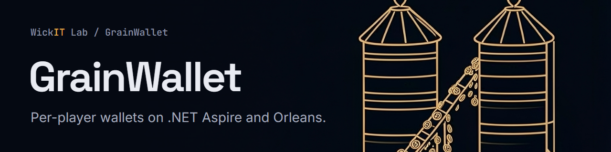

<p align="center">
  
</p>

**Comparison harness for the GrainWallet per-player wallet microservice across versions**

The repo root is an orchestration hub. It carries the comparison dashboard, the workspace tooling and this README. Each numbered version of the wallet service lives in its own committed subfolder (`v1/`, `v2/`, and so on), runs on its own ports, and is driven by the same load scenarios at the same time, so the dashboard can show side by side what a hardening pass actually bought.

The wallet service itself is a per-player microservice on .NET Aspire, Microsoft Orleans, PostgreSQL and Kafka with three HTTP operations: credit funds, debit funds, read balance. The hub's dashboard is an ASP.NET Core app that drives NBomber against every configured version and renders latency percentiles, throughput and failures in one page. Everything runs locally; this is a portfolio and interview artifact, not a live product.

`git clone` is enough. There is no worktree or submodule setup.

## Contents

- [Tech stack](#tech-stack)
- [Prerequisites](#prerequisites)
- [Getting started](#getting-started)
- [Features (built)](#features-built)
- [Repo layout](#repo-layout)
- [What each version is](#what-each-version-is)
- [Adding a version](#adding-a-version)
- [Local CI gates](#local-ci-gates)
- [Security](#security)
- [What's not yet built](#whats-not-yet-built)
- [License](#license)

## Tech stack

| Layer | Technology |
| --- | --- |
| Runtime | .NET 10 |
| Comparison dashboard | ASP.NET Core minimal API with a static HTML, CSS and JS UI |
| Load generation | NBomber |
| Wallet service (v1, v2) | Microsoft Orleans grains behind a minimal API |
| Orchestration (v1, v2) | .NET Aspire AppHost |
| Storage and messaging (v2) | PostgreSQL state and outbox, Kafka event publishing |
| Tests (v1, v2) | xUnit component tests and an NBomber load project in each version |
| CI | GitHub Actions: format, build and test gate, security scan, Dependabot |

## Prerequisites

- .NET 10 SDK
- Docker Desktop running, for each version's Aspire AppHost (Postgres and Kafka containers)
- `gh` CLI (optional; used to drive CI and merge PRs)
- VS Code (optional; the `Compare` compound launch configuration lives in `.vscode/`)

## Getting started

1. Clone the repository:

   ```bash
   git clone https://github.com/w1ck3ds0d4/GrainWallet.git
   cd GrainWallet
   ```

2. Start the comparison. In VS Code, open Run and Debug and pick `Compare: v1 + v2 + Dashboard`. The compound builds both AppHosts in parallel, starts them on the ports the dashboard expects, then launches the dashboard UI.

3. Or start the three pieces by hand from the command line (PowerShell):

   ```powershell
   # Terminal A: v1 on default ports (API 5000, Kafka 19092)
   cd v1
   dotnet run --project src/GrainWallet.AppHost

   # Terminal B: v2 on overridden ports (API 5001, Kafka 19093)
   cd ..\v2
   $env:WALLET_API_HOST_PORT = "5001"
   $env:WALLET_KAFKA_HOST_PORT = "19093"
   dotnet run --project src/GrainWallet.AppHost

   # Terminal C: dashboard at http://localhost:5100
   cd ..
   dotnet run --project src/GrainWallet.Dashboard
   ```

4. Open `http://localhost:5100`, pick a scenario, duration and request rate, and click Run benchmark.

| Piece | Port |
| --- | --- |
| v1 API | 5000 (Kafka 19092) |
| v2 API | 5001 (Kafka 19093) |
| Dashboard | 5100 |

Dashboard configuration is in `src/GrainWallet.Dashboard/appsettings.json`. Its `Dashboard:Projects` list maps each project name to a base URL:

```json
"Projects": [
  { "Name": "v1", "Url": "http://localhost:5000" },
  { "Name": "v2", "Url": "http://localhost:5001" }
]
```

The `Dashboard:Bench` section holds the defaults for warm-up seconds, duration, requests per second, wallet pool size, seed balance, currency, HTTP timeout and per-scenario rate overrides (the `hot-wallet` scenario defaults to 50 requests per second).

Each version folder carries its own `README.md`, `DEMO.md`, tests and load harness, so a single version can also be run and tested in isolation from its own folder.

## Features (built)

### Comparison dashboard

- Runs NBomber scenarios `add-funds`, `deduct-funds`, `get-balance` and `hot-wallet` against every configured version, in parallel or solo.
- Seeds and warms a pool of wallets on each version before measuring.
- A per-run comparison table with mean, p95 and p99 latency for v1 and v2, the difference expressed as a multiplier (`N x faster` or `N x slower`), and a v2 failure column.
- A spec benchmark suite that runs the three endpoints against each project in sequence at 300 seconds and 1000 requests per second per step.
- Per-run reports (NBomber HTML, CSV, Markdown and text plus a `summary.json`) written under a `reports/` folder next to the dashboard binaries, and reloaded on restart so the recent runs table survives.
- Postgres table statistics, a reset of the v2 outbox between sessions, and a clear-history button for a clean measurement session.

### Workspace tooling

- A VS Code `Compare` compound that builds both AppHosts, starts them on their ports and launches the dashboard, with per-version build tasks.
- Local format, build and test gates that match CI (see [Local CI gates](#local-ci-gates)).

## Repo layout

```
GrainWallet/
  src/GrainWallet.Dashboard/   NBomber-driven side-by-side comparison UI
  v1/                          full v1 source (committed)
  v2/                          full v2 source (committed)
  vN/                          add more versions the same way
  .vscode/                     Compare compound and per-version build tasks
  GrainWallet.slnx             Hub solution (Dashboard only)
```

`v1/` and `v2/` are frozen source trees, committed on `main` rather than kept on branches or tags, so one clone reproduces the whole comparison. Further reading: [ARCHITECTURE.md](ARCHITECTURE.md), [HOW_IT_WORKS.md](HOW_IT_WORKS.md) and [CONTRIBUTING.md](CONTRIBUTING.md).

## What each version is

| Folder | What lives there |
| --- | --- |
| [`v1/`](v1/README.md) | Original GrainWallet submission: in-memory LRU, basic outbox drainer, original event names. |
| [`v2/`](v2/README.md) | Hardened revision: `FOR UPDATE SKIP LOCKED` outbox, real LRU idempotency, back-pressure gate (HTTP 503), endpoint pre-grain validation, `synchronous_commit=on`, currency `VARCHAR(3)` plus a CHECK constraint, and an event rename (`DeductionRejected` to `OperationRejected`). |

The v2 changes are listed in full in [v2/CHANGELOG_V2.md](v2/CHANGELOG_V2.md).

## Adding a version

1. Drop the new source under `v3/`, keeping the same project shapes (`Api`, `AppHost`, `Contracts`, `Grains`, `ServiceDefaults`) so the dashboard's assumptions hold.
2. Give it its own port block through the AppHost environment variables so it can run alongside the others.
3. Add a third entry to `Dashboard:Projects` in `src/GrainWallet.Dashboard/appsettings.json`.
4. Copy the `v1 AppHost` launch configuration in `.vscode/launch.json` to a `v3 AppHost` variant, and update the version table above.

## Local CI gates

```powershell
dotnet format GrainWallet.slnx --verify-no-changes --severity error
dotnet build  GrainWallet.slnx -c Release -warnaserror
```

These also run, together with `dotnet test`, on every push and PR to `main` through `.github/workflows/ci.yml`. The hub's `GrainWallet.slnx` references only the Dashboard project; each `vN/` folder ships its own solution if you want to build that version in isolation.

## Security

GrainWallet is a local comparison harness, not a deployed service, and nothing in it is meant to run on the public internet.

- The dashboard and both version APIs bind to localhost ports (5000, 5001, 5100). The AppHosts start local Postgres and Kafka containers that use Aspire's local development defaults, so never reuse those defaults for anything that leaves your machine.
- No secrets, real connection strings or auth tokens are used anywhere in the repo.
- `v1/` and `v2/` are frozen fixtures, not maintained services. Do not deploy them.
- v1 has no back-pressure gate and queues indefinitely under sustained load. That is the point of the comparison, not a bug to fix in v1.

To report a problem, use GitHub's private vulnerability reporting on this repository, or email support@wickitlab.com. See [SECURITY.md](SECURITY.md).

## What's not yet built

- A "v1 vs v2 delta" summary tile on the dashboard that states p95 and p99 deltas as faster or slower and surfaces v2's back-pressure 503 rate. Per-run deltas appear in the comparison table today.
- A first-time-cloner walkthrough with a captured screenshot, after a smoke test of the Compare flow on a clean machine.
- A tagged `v1.0.0` release.
- Later, if a v3 appears: another version folder, charts of latency over benchmark history, and a configuration UI for the bench settings.

See [ROADMAP.md](ROADMAP.md) for the order these were planned in.

## License

This project is dual-licensed:

- [AGPL v3](LICENSE) - free for open-source use. Derivatives and SaaS deployments must release their source under AGPL.
- [Commercial license](COMMERCIAL.md) - for proprietary / closed-source use or hosted services that do not want to comply with AGPL source-disclosure requirements. Contact support@wickitlab.com for terms.
